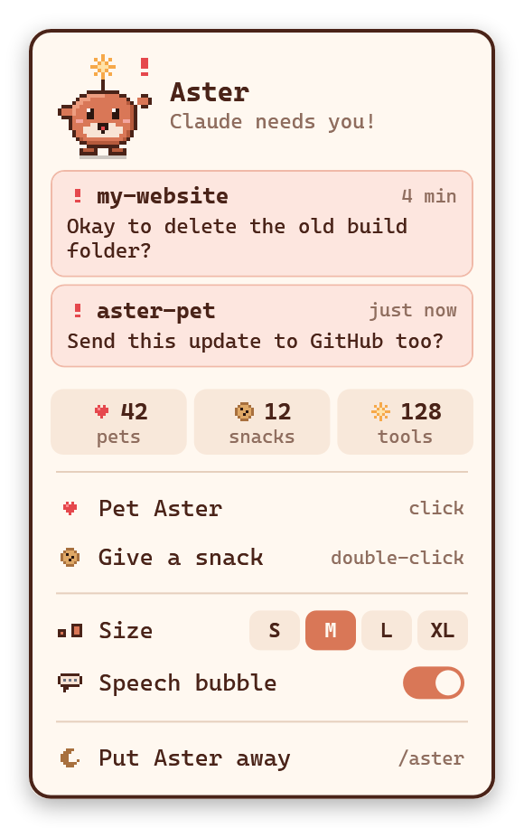

<p align="center">
  
</p>

<h1 align="center">Aster</h1>

<p align="center">A little pixel pet for Claude Code. It floats anywhere on your desktop and reacts to what Claude is doing.</p>

Aster sits on top of your windows, and anywhere it isn't drawn your clicks pass straight through. Drag it wherever you like and it stays there.

While Claude works, Aster works too:

| When Claude is… | Aster… |
|---|---|
| Thinking | looks up, with thought dots |
| Running a command | types on a tiny laptop |
| Reading a file | reads a book |
| Searching | scans with a magnifying glass |
| Writing | scribbles with a pencil |
| Finished | hops around with sparkles |
| Hitting an error | panics, with a sweat drop |
| Idle for 5 minutes | dozes off |
| Waiting for you | jumps up and down waving, with a flashing `!`, and tells you which project needs you |
| Still waiting after 10 minutes | gets **mad**: red face, gritted teeth, steam, stomping and nagging. Petting won't help. A cookie might. |

## Playing with Aster

| Do this | What happens |
|---|---|
| **Drag** | Aster dangles while held, then lands with a puff of dust |
| **Click** | Hearts |
| **Double-click** | A cookie |
| **Scroll** | Bigger or smaller |
| **Right-click** | The menu: where Claude needs you and what it asked, stats, size, speech bubble, put Aster away |

<p align="center">
  
</p>

If you put Aster away, type `/aster` to bring it back.

## Install

You need Windows 10 or 11 and Claude Code. Nothing else: Aster builds itself the first time it runs, using the C# compiler that comes with Windows.

At the prompt of a terminal session:

```
/plugin install aster --marketplace Nennie7W/aster-pet
```

Answer `y` to add the marketplace, then pick a scope.

From a shell:

```bash
claude plugin install aster --marketplace Nennie7W/aster-pet
```

In the Claude desktop app, where `/plugin` does not run: click **+** next to the prompt box, then **Plugins**, **Add marketplace** with `Nennie7W/aster-pet`, then **Add plugin**.

Start a new session and Aster appears in the bottom-right corner of your screen.

## How it works

- `hooks/register.ts` is the Claude Code plugin. It builds and starts the app, then writes what Claude is doing to `~/.claude/aster/status.json`.
- `app/` is the desktop app, a small C#/WPF program that reads that file a few times a second. `app/art.mjs` draws every pixel of Aster from text, and its output is checked in, so building the app doesn't need Node.
- Your position, size and pet count are kept in `~/.claude/aster/settings.json`.
- While a session waits on you, it keeps a small file in `~/.claude/aster/waiting/` with the project folder's name and the question, so the menu can show every session that needs you. The file is cleared once you answer.

Aster has no network code, and nothing leaves your computer. All it learns about your work is which kind of tool Claude is using, plus where and what Claude is asking while it waits on you.

After an update, the new version takes over once the running Aster closes: put Aster away, then type `/aster`.

## Working on Aster

```powershell
.\app\build.ps1 -Out C:\somewhere\Aster.exe
```

That redraws the art with Node and builds the app. `claude plugin test .` runs the plugin's tests.

## License

[MIT](LICENSE). Aster is a fan project, not an official Anthropic product.
